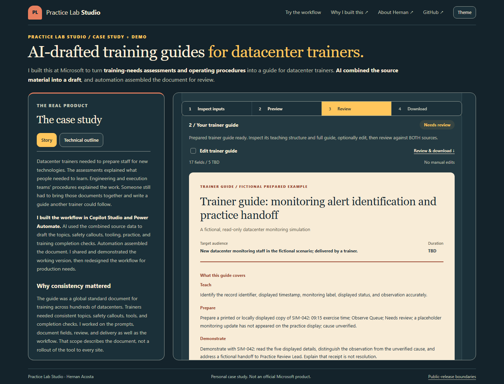

# Hernan Acosta | Portfolio

A personal portfolio of product thinking, hands-on building, and creative work. The homepage introduces Hernan Acosta and connects visitors to selected work, including the interactive Practice Lab Studio project and its product story.

[Visit the portfolio](https://hernanacostaa.github.io/practice-lab-studio/) · [Try Practice Lab Studio](https://hernanacostaa.github.io/practice-lab-studio/lab.html#demo) · [Why I built this](https://hernanacostaa.github.io/practice-lab-studio/case-study.html) · [Architecture](docs/ARCHITECTURE.md) · [Build it in Power Platform](docs/DEPLOYMENT.md)

The public site has three entry points: `index.html` is the personal portfolio, `lab.html` puts the concise case study beside the two-input demo on wider screens, and `case-study.html` is a secondary evidence deep dive with optional planning tools. The case-study and demo panes scroll independently on desktop and stack naturally on mobile. The technical project documentation and local build instructions follow below.

The case-study pane has **Story** and **Technical outline** tabs. The outline connects two source-document nodes to five stages, each with a short explanation and an AI, automation, or human label. It explains the optional retrieval-augmented generation (RAG) path without claiming that these files prove retrieval in the original system. Architecture sources remain in the repository documentation rather than a disclosure in the pane. Changing tabs does not reset a draft or its review.

The homepage gives three kinds of work comparable prominence: Amazon's internal tool and rollout (`index.html#amazon`), Microsoft's AI-assisted authoring (`lab.html`), and reusable training delivery (`index.html#training-delivery`). Compact PayPal and cross-region community accounts support the cases. Its permanent portrait, career chronology, personal sections, and manually controlled photo carousel remain intact. **Save a one-page profile** opens the browser's print dialog, including Save as PDF where available; the profile summarizes selected work, not a full resume.

The primary lab story includes a no-interaction evidence summary and an expandable, clearly labelled prepared-output screenshot. Neither opens an approved demo session or bypasses review. Historical figures requiring scope or publication clearance are omitted from this content draft; proposed pilot targets remain confined to the optional secondary planning page.

## Voice and visual direction

**Resume** in every page's navigation opens the author-supplied general resume PDF in a new tab at `assets/hernan-acosta-resume.pdf`. The build copies it unchanged into the Pages artifact; the printable one-page profile remains a separate summary. The public-release checker permits only this inspected PDF at its source/build paths and exact SHA-256, not arbitrary PDFs. A replacement needs content/metadata review and an updated approval hash.

All three pages share the author-supplied smiling-face-and-wave artwork in `assets/favicon.png`. The build embeds the same PNG data URL in every page, so the favicon needs no network asset or emoji font.

The personal homepage is a friendly introduction, not a project abstract. A conversational greeting and **Explore my work** action lead into product development, technical program delivery, and hands-on building. Formal employment titles and the current/previous-company distinction remain separate from this positioning.

The author-requested Mexican-architecture direction uses cobalt, terracotta, marigold, and warm plaster, with arched portraits and flat architectural color blocks. The [supplied reference](https://paintit.ai/styles/mexican-style-interior-design/img/step3.jpg) informed the palette; it is not copied into the site. This is an art direction, not a claim about the author's identity. All UI colors remain in `--cp-*` tokens, and fonts are local. The homepage defaults to dark even on a light-system preference; the theme button and `scoutTheme=light` remain explicit overrides.

The writing takes cues from [Mailchimp's voice and tone guidance](https://styleguide.mailchimp.com/voice-and-tone/) (warmth, clarity, and unforced humor) and [Nielsen Norman Group's web-reading research](https://www.nngroup.com/articles/how-users-read-on-the-web/) (specific headings, scannable chunks, and credible evidence rather than exaggerated promotion). Those principles inform the presentation, not claims about measured hiring or conversion results.

## Featured project: Practice Lab Studio

**Turn training needs and operating procedures into a consistent trainer guide, with a human in control.**

**System type:** AI-assisted document generation and workflow automation. In technical terms, the platform design is a source-grounded generative AI workflow. RAG describes the optional connected-retrieval path, not a confirmed feature of the original deployment or the offline browser demo.



## The problem

At Microsoft, I identified a repeated authoring problem: training-needs assessments described what datacenter staff needed to learn about new technologies, while engineering and execution teams supplied standard operating procedures. Authors still had to synthesize both into a consistent guide for trainers: topics, safety callouts, tooling and preparation, demonstration, learner practice, and criteria for completing training.

The trainer guide was a global standard document in a context spanning hundreds of datacenters. That is the scope of the document, not a claim of tool deployment at those sites, universal adoption, certified staff, or measured savings.

I built a workflow that used AI to combine the assessment and procedure data into a trainer-guide draft. Automation assembled the document for review. I shared and demonstrated the working version, then redesigned it for production needs. Practice Lab Studio is the public adaptation: the browser opens a prepared example rather than running the original AI or automation.

**Training-needs assessment + SOP → 17-field trainer-guide draft → human review and revisions → Word document**

**Real project. Replacement examples.** This personal case study by **Hernan Acosta** describes work I actually created at Microsoft, not a fictional problem or an unbuilt concept. The demo scenarios, worksheet assets, and infrastructure placeholders were newly authored; internal documents and systems are not included.

## From working version to production-oriented design

1. Identified the repeated work of turning reference material into training exercises.
2. Defined the worksheet structure and built a working source-to-document version.
3. Shared the solution, presented the approach, and demonstrated the workflow.
4. Redesigned for clearer responsibilities, source checks, review, failure handling, and document delivery.
5. Created this public walkthrough so others can explore the design without internal access.

## Try it in two minutes

1. [Open the demo](https://hernanacostaa.github.io/practice-lab-studio/lab.html#demo) and inspect both fictional documents: the training-needs assessment and SOP. You are the training author, not the learner.
2. Select **Create prepared trainer guide**. Read the compact teaching overview, then expand the full 17-field guide. Optional source connections are manually curated fixture teaching aids, not model-generated citations or evidence of the internal UI.
3. Optionally turn on **Edit trainer guide**, add a trainer question, and select **Apply field**. Turn editing off to return to the applied-value preview.
4. Review against **both** inputs, including competencies, tooling, demonstration, practice, operating boundaries, and completion criteria. Confirm review, then download **Word**. Secondary **JSON** contains the same 17 fields.

The preview shows only **applied** values. Pending edits never change it or bypass approval, even if you leave edit mode; apply or discard them before approving. Changing the guide or resetting clears the preview and all edits. Reloading also clears this in-memory session.

Distinct source excerpts are visible immediately; each document also has expandable full text. Optional failure checks are inside **Behind the scenes: workflow trace**, not the main source panel. Simulate an unavailable assessment or SOP there: either failure clears the draft and stops drafting, with no fallback. Restore the input and retry, or reset to restore both.

Choose **Logistics** to compare fictional receiving records with advance shipment information, or **IT service desk** to classify fictional incident reports and prepare a routing handoff. Each has its own L&D assessment, engineering SOP, prepared guide, trainer edit, and Word download. These are public illustrations of established industry tasks, not additional projects the author deployed. [Research and example provenance](docs/CASE_STUDY.md#public-examples) distinguish the published guidance from the invented local policies and records.

Switching starts fresh; a confirmation protects pending/applied edits and approval. Cancelling preserves the current session. Reset restores both inputs for the selected example. No goods handling, live systems, real accounts, or messages are involved. Completion concerns the exercise only, not staff qualification. Metadata and duration can remain `TBD`; required instructional and boundary fields cannot be replaced with `TBD`. The first two Notes paragraphs are fixed simulation boundaries: edits may add fictional notes but must preserve those paragraphs verbatim. This narrow guard does not certify a manual rewrite's accuracy; human review against both sources remains essential.

**Demo disclosure:** creating an example loads a prepared, pre-authored fixture, not a live AI response. Editing, validation, approval gates, and document exports are functional. There is no sign-in, API key, cloud connection, telemetry, browser storage, or upload of field contents. Use fictional material only.

## What you can run in this public version

| Component | Included | Status |
|---|---|---|
| Browser walkthrough | One fictional scenario, two required source documents, one prepared 17-field trainer guide | Runs locally; no live AI |
| Review workflow | Manual edits, explicit missing facts, reapproval after changes | Implemented |
| Document export | Editable `.docx` and exact-schema `.json` downloads | Implemented locally |
| Prompt contracts | ExtractPA, EditPA, FormatPreview, GeneratePA | Reusable text; configure in your own environment |
| Controlled topic and delivery flow | Source gates, review loop, error paths, replaceable connections | Descriptive blueprints, **not importable solution exports** |
| Copilot Studio + Power Automate deployment | Instructions and original sample template | Optional; **not deployed by this repository** |
| Business impact | Proposed measurement plan and illustrative calculator | No internal business results published; planning figures are not reported outcomes |

These statuses describe the public repository, not whether the original project was built. The browser layer is a demonstration adapter. The reusable platform design preserves four prompt responsibilities and a controlled source-to-document sequence; it does not require the browser application in the platform runtime.

## Design decisions worth exploring

- **A link is not source content.** Retrieval must produce actual text before extraction can proceed.
- **One field contract.** All 17 fields are strings, and the same keys survive extraction, edits, preview, and export.
- **Unknown stays unknown.** Missing metadata and duration remain `TBD`; required instruction and operating boundaries must be present before export.
- **Review has meaning.** Pending edits block export, and applied changes invalidate prior approval.
- **Formatting is not generation.** Document assembly places the reviewed content without adding technical claims.
- **Cloud dependencies are optional.** Public examples do not require an organization's tenant, documents, or connectors.

Read the [secondary evidence deep dive](https://hernanacostaa.github.io/practice-lab-studio/case-study.html) for decisions and evidence limits. Its optional measurement and economics tools are explicitly illustrative, not original project metrics or measured outcomes. The model includes unsuccessful attempts, manual fallback, running costs, and setup cost; capacity value is not cash savings. The primary case study and demo contain no hypothetical economics.

The optional [technical evidence deep dive](docs/CASE_STUDY.md) and [architecture](docs/ARCHITECTURE.md) provide additional design and implementation context.

## Run locally

Requires **Node.js 22 or newer** and npm.

```sh
npm ci
npm run build
npm run dev
```

Open `http://127.0.0.1:4173` for the portfolio, `/lab.html#demo` for Practice Lab Studio, and `/case-study.html` for its product story. All three generated HTML pages in `dist/` are self-contained and can be opened directly without a server or network connection. Keep `index.html`, `lab.html`, and `case-study.html` together for navigation between them. The lab still works independently, including Word export. Its story and **About Hernan** links open a new tab so an in-progress worksheet is not lost. All three pages default to dark, regardless of system preference; the theme toggle or an explicit `?scoutTheme=light` selects light mode. Only valid `light`/`dark` overrides are accepted. The selected theme travels in internal links, without browser storage. Rebuild after changing source files.

Legacy root `#demo` and `#design` bookmarks redirect to the interactive project at `lab.html`.

The build injects `src/palette.css` before each page's component styles. Portfolio, demo, and story share its Mexican-architecture-inspired background, text, accent, and control colors, plus local serif display headings; there is no separate app palette. Page-specific layout styles remain separate, with no CSS imports or network assets. The portfolio's curated PNG/WebP derivatives are embedded as data URIs. Only `assets/portfolio/social-preview.png` is copied as a separate image, to `dist/social-preview.png`, for link previews; page rendering does not fetch it. GitHub Pages continues deploying `dist/` at the existing repository URL, now with the personal portfolio as its default entry point.

```sh
npm test
npm run check:public
npx playwright install chromium
npm run test:e2e
```

`npm run verify` combines domain/document tests, the production build, and a public-release pattern check. Browser tests separately cover the review workflow, all scenarios, source failures, safe text rendering, downloads, and responsive layouts. The automated checks complement, but do not replace, content and provenance review.

## Updating portfolio photos

Update only curated, metadata-sanitized WebP derivatives under `assets/portfolio/`, using lowercase, hyphen-separated filenames. Update their homepage references and captions, then run `npm run build` to embed the new images. Keep original photographs outside the repository; never use original source paths or private file locations in public HTML, captions, or documentation. Review the rebuilt pages and `social-preview.png` under the [publication boundaries](docs/PUBLIC_RELEASE.md) before release.

## Repository map

| Path | Purpose |
|---|---|
| `src/palette.css` | Shared light/dark screen palette, injected before every page's component styles |
| `index.html`, `src/portfolio.mjs`, `src/portfolio.css` | Personal portfolio, manual photo carousel, theme navigation, and print profile |
| `assets/portfolio/` | Curated, metadata-sanitized portfolio derivatives and the social preview; no originals |
| `lab.html` | Practice Lab Studio's interactive, offline project page |
| `src/core.mjs` | Worksheet contract and deterministic demo domain logic |
| `src/samples.mjs` | `DEMO_SAMPLES`: logistics and service-desk source pairs; `SAMPLES` and `LEGACY_MONITORING_SAMPLE`: regression assets, not browser choices |
| `src/app.mjs` | Browser state, review, editing, and local downloads |
| `case-study.html` | Anonymized product-manager story, decisions, metrics, and evidence limits |
| `src/business-case.mjs` | Tested illustrative capacity/cost model; no real business data |
| `src/story.mjs` | Local-only calculator interaction |
| `src/document.mjs` | Original Word document layout |
| `schemas/worksheet.schema.json` | Exact 17-field JSON contract |
| `samples/` | Source text, example JSON, generated Word examples, and a blank template |
| `platform/` | Sanitized prompt and workflow blueprints |
| `docs/` | Product case study, architecture, deployment, and release boundaries |
| `tests/` | Domain, document, and browser tests |
| `.github/workflows/` | Verification and GitHub Pages deployment |

To regenerate the Word examples and template from the public fixtures:

```sh
node scripts/make-examples.mjs
```

The script generates `samples/logistics-trainer-guide.docx`, `service-desk-trainer-guide.docx`, both examples' assessment/SOP text copies, and the template. The canonical inputs are `logistics-sources.json` and `service-desk-sources.json`; prepared outputs are `logistics.json` and `service-desk.json`. Four older workshop/library/photos/monitoring Word examples remain unchanged legacy regression assets, not browser choices. There are seven Word packages in total, including the template.

Optional package/XML verification of all five documents uses Python 3 and no additional packages: `python scripts/validate-documents.py`.

## Boundaries

This is a personal portfolio, not an official Microsoft product or an endorsement. Practice Lab Studio is an independent public adaptation of real work I created at Microsoft. Its replacement examples are fictional; the problem, working version, sharing, presentations, demos, and production-oriented redesign are part of the real project story. It contains no original organizational source documents, screenshots, recordings, solution exports, connection bindings, or inherited Git history. Personal portfolio photographs are separate from the fictional project fixtures. Replacing names alone does not make proprietary material publishable.

Image preparation is not publication approval. Review the final crops, captions, recognizable people, and any third-party artwork; confirm rights and permissions before release. Removing metadata does not establish those rights. Obtain the author's final approval before pushing or publishing portfolio changes.

The optional cloud build needs your own eligible Power Platform environment and approved connections. Do not add credentials or private source material to this repository. See [public-release boundaries](docs/PUBLIC_RELEASE.md) and [third-party notices](THIRD_PARTY_NOTICES.md).

## License

Original public project code, documentation, and fictional examples are provided under the [MIT License](LICENSE). Third-party libraries retain their own licenses. Public Microsoft, PayPal, and Amazon marks identify the author's work experience, not endorsement; their provenance and trademark boundaries are in [third-party notices](THIRD_PARTY_NOTICES.md). No private organizational templates or procedures are included.

**Personal-photo exception:** The photographic derivatives listed in [personal photograph rights](THIRD_PARTY_NOTICES.md#personal-photograph-rights) are **not offered under the repository's MIT code license**, including copies embedded in `social-preview.png` or built HTML. Rights remain with their respective rights holders; inclusion does not imply endorsement or permission to reuse them. `lab-preview.webp` is a screenshot of this public application, not a personal photograph in that category. The author must confirm public-use permissions before publication.
